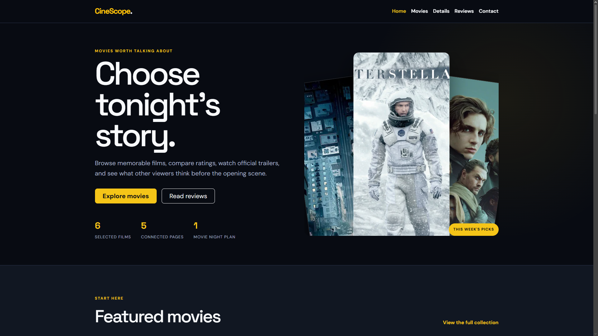
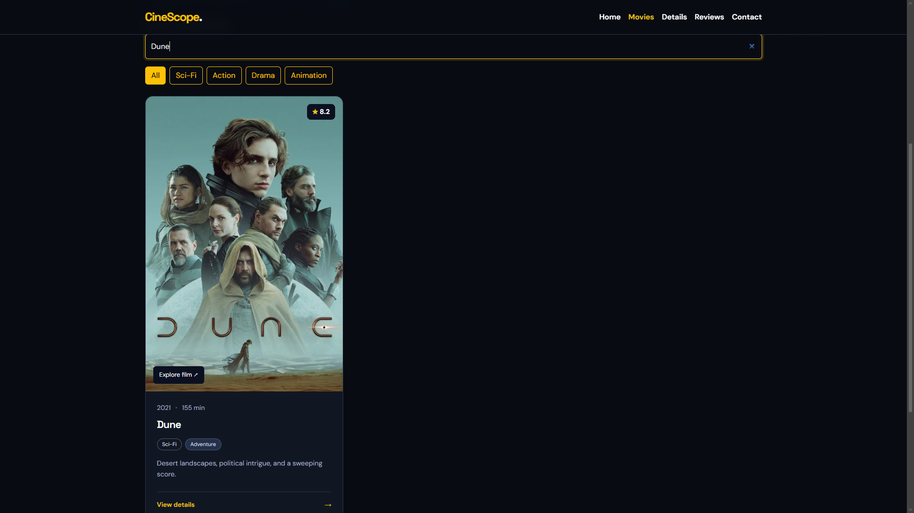
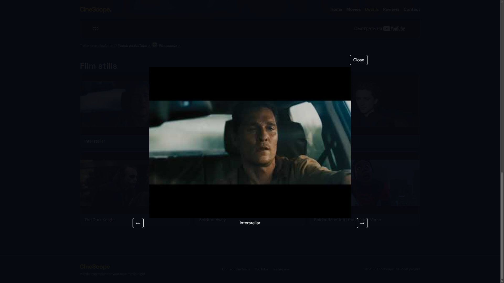
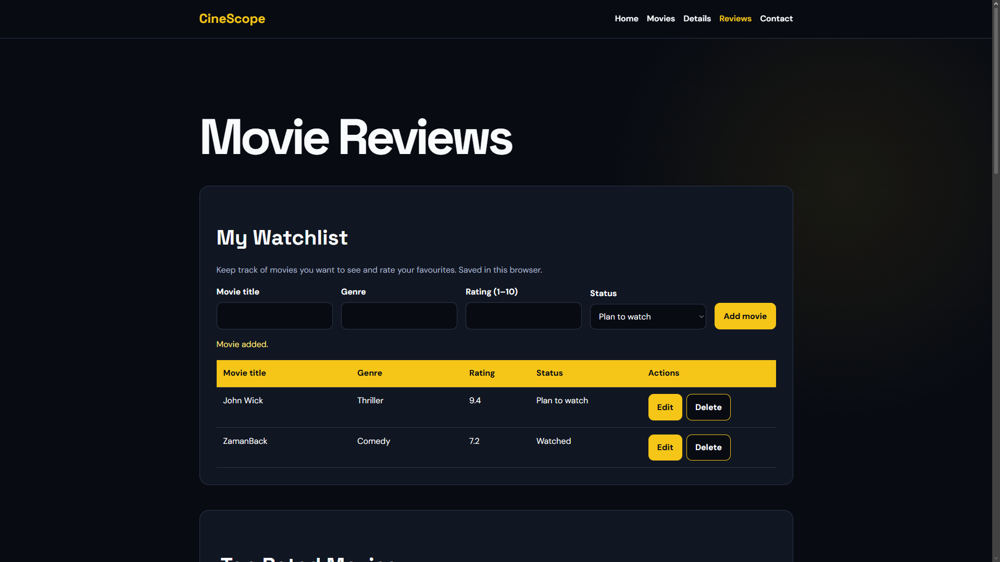
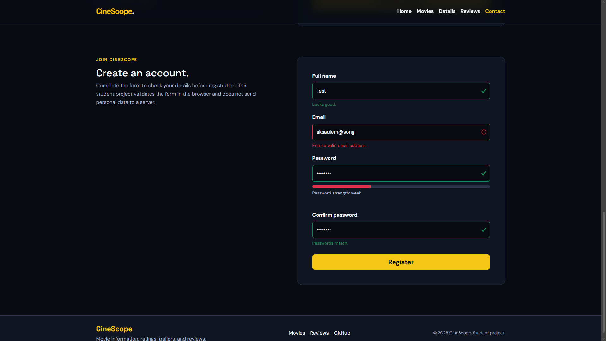
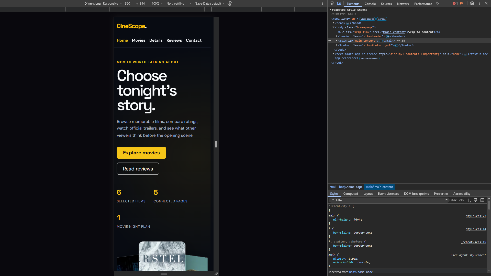
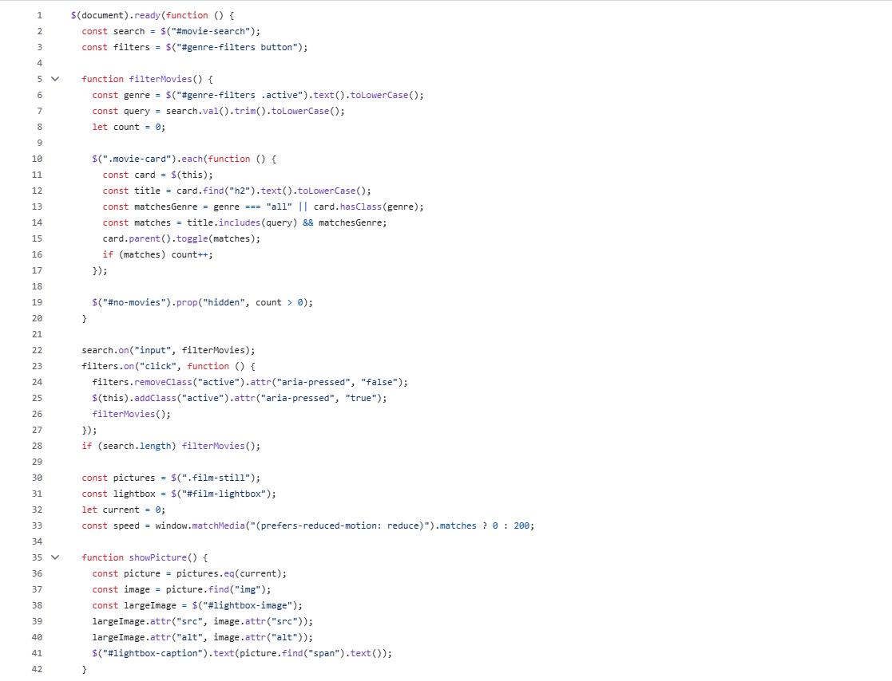
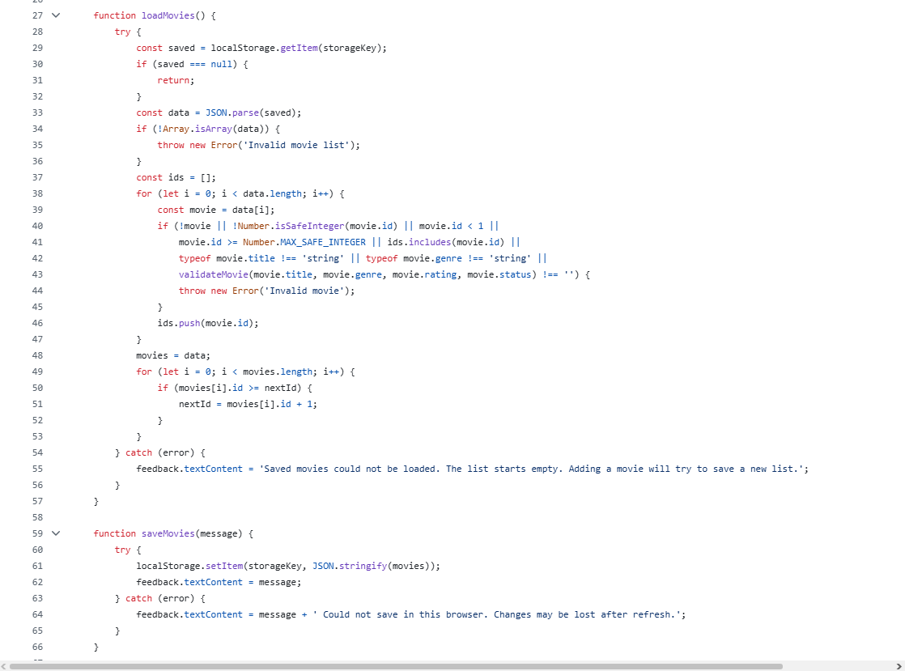
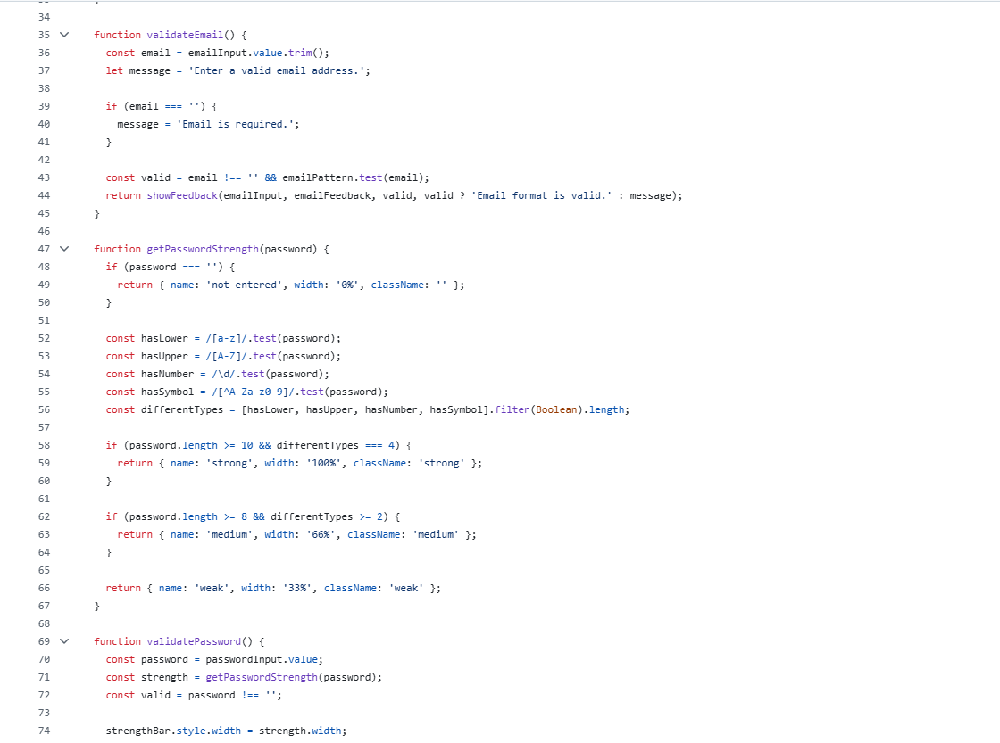

# CineScope

CineScope is a movie website created for the Frontend Development midterm and expanded for the endterm project. A visitor can browse movies, search by title, filter by genre, watch trailers, manage a personal watchlist and use a registration form with validation.

## Live website

The project is published with GitHub Pages:

**[Open CineScope](https://temirlandosdos.github.io/movie-midterm-2026/)**

## Team

- Temirlan Dosmukhambetov — IT-2502
- Chingizkhan
- Nurkadir

## Pages

- **Home** — project introduction, featured movies and genres
- **Movies** — responsive movie catalog with search and genre filters
- **Details** — movie information, ratings, trailers and image gallery
- **Reviews** — ratings, reviews and personal watchlist
- **Contact** — team information and registration form

All pages use the same navigation and visual style.

## Endterm features

### Movie search and filters

The Movies page uses jQuery to search movies by title and filter cards by genre. The page also shows a message when no movies match the selected options.

### Interactive gallery

The Details page contains a modal image gallery. The user can open a picture, move to the previous or next image, use the keyboard arrows and close the gallery with the Escape key.

### Personal watchlist

The Reviews page contains a CRUD watchlist made with JavaScript. A visitor can:

- add a movie;
- edit its information;
- delete it after confirmation;
- choose a watching status;
- save the list in the browser with `localStorage`.

The form checks the title, genre, rating and status before changing the table.

### Registration validation

The Contact page contains a registration form with real-time validation:

- required name;
- email format check;
- password strength indicator;
- password confirmation;
- success and error messages.

The form is a student demonstration, so personal data is not sent to a server.

## Technologies

- HTML5
- CSS3
- Bootstrap 5.3
- JavaScript
- jQuery
- DOM manipulation
- `localStorage`
- Git and GitHub
- GitHub Pages

The project is a static website and does not require installation or a build command.

## Team contribution

### Temirlan Dosmukhambetov

Created the Home and Contact pages, connected the shared design and navigation, added registration form validation, integrated the team branches and prepared the final repository and documentation.

### Chingizkhan

Created the Movies and Details pages, movie search, genre filters and the interactive image gallery.

### Nurkadir

Created the Reviews page and the personal watchlist with add, edit, delete, validation and `localStorage`.

## Project screenshots

The following places are reserved for the final screenshots.

### 1. Home page

Shows the main page, navigation and hero section.

### 2. Movie search and genre filter

Shows the Movies page after entering a search query or selecting a genre.

### 3. Movie details and gallery

Shows a movie description and the opened interactive gallery.

### 4. Watchlist

Shows several added movies and the Edit/Delete controls.

### 5. Registration validation

Shows the registration form with validation messages and the password strength indicator.

### 6. Mobile layout

Shows the website navigation and content at mobile width.

## Code screenshots

### jQuery search and filtering

### DOM and localStorage watchlist

### Registration form validation

## How to run locally

1. Download or clone the repository.
2. Open the project folder in WebStorm or another code editor.
3. Open `index.html` in a browser.

Repository: [github.com/TemirlanDosDos/movie-midterm-2026](https://github.com/TemirlanDosDos/movie-midterm-2026)
